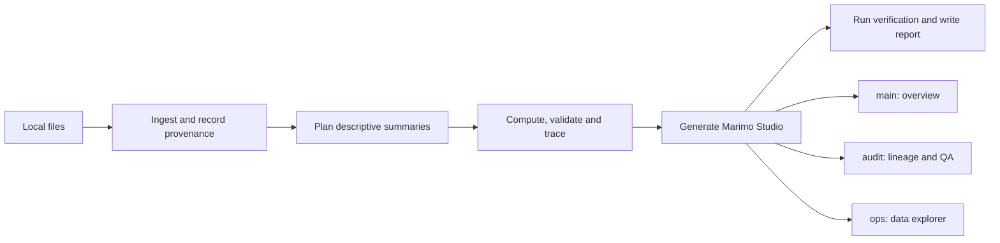

# Nouc Studio

[](LICENSE)
[](pyproject.toml)

Nouc Studio turns local files into an exploratory Marimo Studio with three views:
an overview, calculation lineage and QA, and a data explorer. It records source
hashes, transformations, checks and assumptions alongside computed summaries.

**Status: prototype.** The generic planner produces counts, totals and descriptive
means. A business request such as “calculate retention” still needs agreed rules,
explicit implementation and acceptance tests. Optional model use currently adds
an assumption to the plan; it does not generate the business calculations.

## Try the synthetic example

From a source checkout with Python 3.12+ and [uv](https://docs.astral.sh/uv/):

```bash
uv sync --locked
uv run python examples/offline_walkthrough.py
uv run nouc studio dist/public-example/app.py
```

The walkthrough uses six synthetic CSV rows, disables LLM calls and gives both
memory tiers fresh temporary directories. It checks the expected totals and runs
the verification gate with ty. Choose a new output directory with `--output`
when rerunning it. The generated notebook uses the synchronized project
environment through the launcher. With Pixi, use `pixi run example-build` once,
then `pixi run app`; `pixi run edit` opens the editor and `pixi run check-app`
diagnoses build and Python failures. See [launch and preview recovery](docs/studio-launch.md).

Read the [walkthrough and examples](examples/README.md) for expected output,
artifact contents and the separate browser acceptance check. Downloads during
environment setup and browser assets are separate from disabling LLM calls.

## Documentation

| Task | Guide |
| --- | --- |
| Run examples and inspect evidence | [Examples](examples/README.md) |
| Launch, edit or repair a Studio preview | [Studio launch](docs/studio-launch.md) |
| Adapt concrete official Studio examples | [Agent view-authoring skill](skills/studio-view-authoring/SKILL.md) |
| Start a consumer project with Copilot | [New project](docs/new-project.md) |
| Understand the pipeline and its limits | [Architecture](docs/architecture.md) |
| Evaluate OpenUI and challenge the current design | [Review dated 23 October 2026](docs/openui-review-2026-10.md) |
| Keep private data out of a public repository | [Public data and artifacts](docs/public-data.md) |
| Build or publish Python packages | [Publishing](docs/publishing.md) |
| Develop and verify changes | [Contributing](CONTRIBUTING.md) |

## Start your own project

Install `nouc-studio[verify]` in a uv project, then run:

```bash
uv run nouc init --agent copilot
```

Select **Nouc Studio** in VS Code Copilot and describe the decision or workflow
you need. The bundled instructions require the agent to clarify consequential
business rules, save a brief, implement and verify the app, and check its actual
desktop workflows. The [new-project guide](docs/new-project.md) covers package
indexes, isolated initialization and upgrades.

The initializer writes project instructions and skills only when explicitly run.
Installing or importing Nouc does not initialize a project. Copilot's IDE sign-in
and Nouc's optional runtime model credentials are separate.

## What runs today



The five named agent stages execute sequentially. Polars and DuckDB handle data;
Pointblank checks tables; Monty evaluates formula snippets; rustworkx stores the
lineage DAG. The generated notebook and its views use Marimo and marimo-studio.
See the [architecture guide](docs/architecture.md) for the distinction between
source ingestion, calculation evidence and domain correctness.

Supported input readers cover CSV, Excel, Parquet, PDF, DOCX, PPTX, Markdown,
text, images and source code. Extraction support varies by format. Ingesting a
formula file or methodology document does not execute or adopt its rules.

## Models and configuration

The public [configuration template](.env.example) starts in `offline` mode.
Set `INSIGHTS_DEFAULT_LLM_MODEL=offline` explicitly when model calls are unwanted,
including when the parent shell contains credentials. The Python configuration
has its own default; the walkthrough overrides it directly.

```bash
uv run nouc models
uv run nouc ground --module pydantic_ai.models --symbol KnownModelName
```

`models` reports configuration and credential presence. `ground` inspects an
installed symbol. Neither command authenticates to a provider or proves that a
model identifier is available to your account. Verify identifiers and SDK extras
against the provider and your installed PydanticAI version before enabling a
cloud or self-hosted model. The base dependency declares the Google extra.

## Verification and limits

```bash
uv run ruff check src tests scripts examples/offline_walkthrough.py examples/ui_contract.py
uv run ty check src tests scripts examples/offline_walkthrough.py examples/ui_contract.py
uv run pytest -v
```

The gate checks notebook structure, execution and selected static/layout rules.
Domain assertions and real browser interaction checks remain separate. A
`TrustGrade` summarizes configured heuristics; it is not a calibrated probability.
The legacy `confidence_interval_95` field carries heuristic ranges in the generic
pipeline, not statistical 95% confidence intervals.

Use the prototype with trusted local inputs. The SQL explorer's keyword filters
are not a security sandbox. `nouc build` returns nonzero when its notebook,
view, data QA or explanation checks fail. Inspect the report and use
`nouc studio <app.py> --check` to diagnose view builds and Python execution.

## Public repository boundaries

Keep credentials, business inputs and raw failure memory local. The generator
currently copies memory episodes, including global episodes, into
`adaptive_memory_snapshot.json`. Generated reports can also contain prompts,
source records and absolute paths. Ignoring the original memory directory does
not sanitize a generated bundle.

The walkthrough isolates memory. Keep its generated `dist/` files local too;
publish only deliberately reviewed artifacts. See the [public-data guide](docs/public-data.md)
for Git history and package boundaries.

## Names and compatibility

The distribution is `nouc-studio`, the Python import is `nouc_studio`, and the
primary CLI is `nouc`. The `nouc-studio` and `insights` command aliases remain
available. Existing `INSIGHTS_*` settings and `.insights/memory/` remain supported.
Global memory uses `~/.nouc-studio/memory/`, reusing an existing
`~/.prism-studio/memory/` if the new directory does not exist. Replace historical
`prism_studio` Python imports with `nouc_studio`.

Licensed under [Apache-2.0](LICENSE). Original attribution is retained in [NOTICE](NOTICE).

