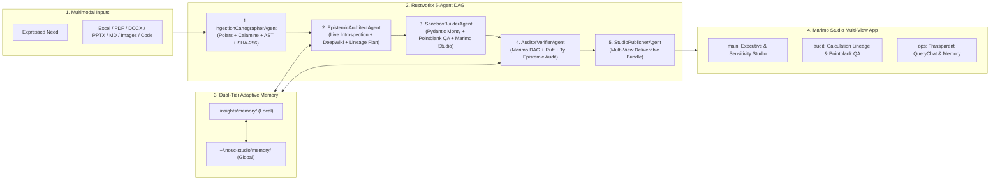

# Nouc Studio — Multi-Agent Epistemic Marimo Studio System

[](LICENSE)
[](pyproject.toml)
[](https://github.com/astral-sh/uv)
[](https://github.com/astral-sh/ruff)

**Nouc Studio** (`nouc`) is a prototype multi-agent system that uses **Marimo** and **Pydantic Monty** to turn a heterogeneous file bundle (Excel, CSV, Parquet, PDF, DOCX, PPTX, Markdown, TXT, Images, Source Code) into an **interactive multi-view `marimo-studio` application** with source provenance, exploratory summaries, QA and calculation traces. The generic planner does not yet translate an expressed user need into domain-specific business calculations.

The Python distribution is `nouc-studio`, the import is `nouc_studio`, and the
primary command is `nouc` (`nouc-studio` and the existing `insights` alias also work).
After updating an existing checkout, run `uv sync --locked`. Python integrations
must replace `prism_studio` imports with `nouc_studio`. Existing `INSIGHTS_*`
settings and project-local `.insights/memory/` remain supported. Global memory
uses `~/.nouc-studio/memory/` for new installations and reuses an existing
`~/.prism-studio/memory/` when the new directory does not exist. Historical demo
reviews retain the name used when they were recorded.

Raw local and global failure memory (`.insights/memory/`, `~/.nouc-studio/memory/`)
may contain prompts, business data or diagnostic paths. It is untracked and never
ships: share only reviewed, anonymized prevention rules.

---

## Start a fresh project with VS Code Copilot

Install the published package with `uv`, then run `uv run nouc init --agent copilot`
inside your project. The explicit initializer installs the agent, instructions and
five skills from the wheel; no files need to be copied from this repository.
Use the [`verify` extra and the new-project guide](docs/new-project.md) for the
complete TestPyPI setup, Python pinning and the short VS Code startup sequence.
Installing or importing the package alone does not modify your project.

The PyPI release candidate also supports isolated initialization with
`uvx --python 3.13 --from "nouc-studio==0.1.0rc1" nouc init --agent copilot`.
Use `uv add` and `uv run` for the application's own locked environment; `uvx`
does not install the project or its dependencies into that environment.

Choose **Nouc Studio** in Copilot and describe the need in ordinary language. The
agent clarifies the business rules, saves the brief, then plans the desktop
experience with a UI/UX specialist when delegation is available. Browser checks
of real interactions are required alongside the calculation and code checks.
Audit details, SQL and logs belong behind task-oriented navigation rather than
in a long stack of outputs. Copilot's IDE sign-in is separate from Nouc's optional
runtime model API configuration below.

---

## Architecture Overview



---

## Core Design Principles

1. **Zero `pip` Policy**: Package and environment management relies exclusively on **`uv`** (`pyproject.toml`, `uv.lock`, PEP 723 inline script metadata) and **`pixi`** (`pixi.toml`).
2. **Zero Blind Trust in LLM Parametric Knowledge**:
   - Live runtime symbol & signature introspection (`verify_live_python_symbol`) checks installed modules, callables, and `TypedDict` schemas before code generation.
   - Native integration with **DeepWiki MCP** (`https://mcp.deepwiki.com/mcp`), official **Google GenAI SDK** (`google-genai`), and packaged **`agent-plugins`** (`marimo-studio` skill references).
3. **Graph-First Code & Calculation Lineage (`rustworkx` + `pydantic`)**:
   - Every ingested file, sheet/page/line coordinate, SHA-256 digest, AST symbol, Polars/SQL transformation, Posit `pointblank` validation check, explicit assumption, and output metric is modeled in a strict `rustworkx.PyDiGraph` DAG (`LineageGraphEngine`).
4. **Explainability, Proof & Epistemic Uncertainty**:
   - Every computed number carries an `UncertaintyProfile`: a heuristic uncertainty range `[low, high]`, relative epistemic uncertainty `±%`, data completeness ratio, Pointblank QA pass rate, discrete `TrustGrade` (`A` through `F`), and a step-by-step calculation trace audited by `deepeval_auditor`. These ranges combine configured assumptions and data-quality penalties; they are not statistical 95% confidence intervals.
5. **Dual-Tier Self-Healing Memory (Local + Global Cross-Project)**:
   - Failures encountered during development or verification (`ruff`, `ty`, `marimo` reactive DAG, `pydantic-monty`, `pointblank`, `marimo-studio`, `google-genai`) and their empirically verified fixes are stored locally in `.insights/memory/` and automatically promoted to `~/.nouc-studio/memory/` so future projects never repeat the same mistakes.

---

## SOTA Stack

| Layer | Technology |
| :--- | :--- |
| **Environment & Packaging** | `uv`, `pixi` |
| **Static & Type Safety** | `ruff`, `ty` (Astral), `pydantic` v2 |
| **Sandboxes & Execution** | `marimo` (`--sandbox`, `marimo-pair`), `pydantic-monty` (Rust Python sandbox) |
| **Multi-View Studio & UI** | `marimo-studio` (v0.3+), native reactive `marimo.ui` controls, Posit `querychat` pattern |
| **Data Processing & QA** | `polars`, `fastexcel` (Rust Calamine), `duckdb`, Posit `pointblank` |
| **Graph & Lineage** | `rustworkx` (`PyDiGraph`) |
| **Agents & Grounding** | `pydantic-ai`, `google-genai`, DeepWiki MCP (`https://mcp.deepwiki.com/mcp`), `deepeval`-compatible epistemic auditor |

---

## Model Setup: Cloud APIs, Local/Self-Hosted AI & GitHub Models

Nouc Studio is **model-agnostic**. You can run it with Cloud frontier models, **100% local / self-hosted open-weights models** (air-gapped / sovereign), **GitHub Models / Copilot**, or in **Deterministic Offline Mode**.

Copy [`.env.example`](.env.example) to `.env` and inspect your active configuration at any time with:
```bash
uv run nouc models
```

### 1. Cloud API Keys (Gemini 3.8 Flash / Gemini 4, Claude Sonnet 5.5, GPT-6 Sol)

All model identifiers are verified live against `pydantic_ai.models.KnownModelName`:

```bash
# Option 1A: Google Gemini 3.8 Flash or Gemini 4 Argon via official `google-genai` SDK
export INSIGHTS_DEFAULT_LLM_MODEL="google:gemini-3.8-flash"
# Or flagship Gemini 4:
export INSIGHTS_DEFAULT_LLM_MODEL="google:gemini-4-argon"
export GEMINI_API_KEY="your-gemini-api-key"

# Option 1B: Google Cloud Vertex AI (IAM / ADC authentication)
export INSIGHTS_DEFAULT_LLM_MODEL="google-cloud:gemini-4-argon"

# Option 1C: Anthropic Claude Sonnet 5.5 / Opus 5.5
export INSIGHTS_DEFAULT_LLM_MODEL="anthropic:claude-sonnet-5-5"
# Or: export INSIGHTS_DEFAULT_LLM_MODEL="anthropic:claude-opus-5-5"
export ANTHROPIC_API_KEY="sk-ant-..."

# Option 1D: OpenAI GPT-6 Sol / GPT-6.1 Sol
export INSIGHTS_DEFAULT_LLM_MODEL="openai:gpt-6-sol"
# Or: export INSIGHTS_DEFAULT_LLM_MODEL="openai:gpt-6.1-sol"
export OPENAI_API_KEY="sk-..."
```

### 2. Local & Self-Hosted AI (Ollama, vLLM, LM Studio, llama.cpp, SGLang)

Nouc Studio natively supports local and self-hosted open-weights models (`Qwen3-Coder`, `Gemma 4`, `DeepSeek V4`) without requiring any external cloud API key:

* **Ollama (Local Daemon on port `11434`)**:
  ```bash
  ollama pull qwen3-coder:30b
  export INSIGHTS_DEFAULT_LLM_MODEL="ollama:qwen3-coder:30b"
  # Or: export INSIGHTS_DEFAULT_LLM_MODEL="ollama:gemma4:31b"
  export INSIGHTS_LLM_BASE_URL="http://localhost:11434/v1"
  ```
* **vLLM / SGLang / TGI (Self-Hosted GPU Server on port `8000`)**:
  ```bash
  export INSIGHTS_DEFAULT_LLM_MODEL="openai:Qwen/Qwen3-Coder-Next"
  # Or: export INSIGHTS_DEFAULT_LLM_MODEL="openai:deepseek-ai/DeepSeek-V4-Pro"
  # Or: export INSIGHTS_DEFAULT_LLM_MODEL="openai:google/gemma-4-31b-it"
  export INSIGHTS_LLM_BASE_URL="http://localhost:8000/v1"
  export INSIGHTS_LLM_API_KEY="local-no-key"
  ```
* **LM Studio / `llama.cpp` Server (Local OpenAI-compatible Server on port `1234`)**:
  ```bash
  export INSIGHTS_DEFAULT_LLM_MODEL="openai:local-model"
  export INSIGHTS_LLM_BASE_URL="http://localhost:1234/v1"
  export INSIGHTS_LLM_API_KEY="lm-studio"
  ```

### 3. GitHub Copilot / GitHub Models Inference API

If you have a GitHub Personal Access Token or Copilot-enabled `GITHUB_TOKEN`, Nouc Studio automatically routes `openai:*` models through `https://models.github.ai/inference`:

```bash
export INSIGHTS_DEFAULT_LLM_MODEL="openai:gpt-6-sol"
export INSIGHTS_LLM_BASE_URL="https://models.github.ai/inference"
export GITHUB_TOKEN="ghp_..."
```

### 4. Deterministic Offline Mode (Zero LLM Calls)

When no API key or local server is active (or when `INSIGHTS_DEFAULT_LLM_MODEL="offline"`), Nouc Studio executes the full deterministic AST, Polars, Pointblank QA, Pydantic Monty sandbox, and `marimo-studio` pipeline completely offline.

---

## Using Nouc Studio with Coding Agents (GitHub Copilot, Claude Code, Cursor, Antigravity & Marimo Pair)

Nouc Studio is designed to pair directly with external Coding Agents and live IDE assistants:

### Start with a natural-language need in VS Code

Create a fresh project and install the published `nouc-studio[verify]` package
with `uv`, following the [new-project guide](docs/new-project.md). Run
`uv run nouc init --agent copilot` in that project, then open its folder in VS Code
with GitHub Copilot signed in. Select the workspace's **Nouc Studio** entry in the
chat agent selector. The initializer installs
[`.github/agents/nouc-studio.agent.md`](.github/agents/nouc-studio.agent.md), which
puts the requirements conversation directly in the selected agent's prompt.
Make your input files available in the workspace and describe the decision or
workflow you need, for example:

> I have account and support exports in `data/`. I need to understand retention
> and decide which customers we should contact first this week.

No tester role, slash command, or CLI recipe is required. Repository instructions
require Copilot to ask a few contextual questions first, offering options and a
free-text alternative, and wait for answers before implementation. The prescribed
workflow then records the agreed brief, builds, verifies and launches the
application. A published-wheel trial verified setup and a completed assisted
application run with defects corrected after review. Live valuation covered one
of the three ISINs tested; unverified
candidates were excluded. Domain tests and real desktop interaction checks remain
necessary. Generic Agent mode has also been tested and has not consistently
followed the question format.
Known answers carry over to follow-up requests.

Check that `.github/copilot-instructions.md` appears in Copilot's loaded instruction
references; loading and native question controls depend on the VS Code harness and
configuration. If interactive questions are unavailable, the agent must offer the
same choices in chat. These are agent instructions, not a hard CLI enforcement
mechanism: `nouc build --need` itself is currently non-interactive and the generic
planner still requires explicit domain implementation for business-specific rules.

Scripted tester runs are historical engineering evidence, not proof of this intake
experience.

### Agent integrations

1. **GitHub Copilot (VS Code, JetBrains, GitHub.com Coding Agent)**:
   - Repository-wide rules are pre-configured in [`.github/copilot-instructions.md`](.github/copilot-instructions.md).
   - Repository instructions require Copilot to follow the **Zero-`pip`** policy, run `uv run nouc ground` before using library APIs, and consult/update adaptive failure memory (`uv run nouc memory rules`).
2. **Claude Code, Cursor, Windsurf & Google Antigravity**:
   - Universal agent instructions are provided in [`AGENTS.md`](AGENTS.md) alongside 5 modular skills in [`skills/`](skills/):
     - [`skills/marimo-pair-sandbox/SKILL.md`](skills/marimo-pair-sandbox/SKILL.md)
     - [`skills/deepwiki-live-grounding/SKILL.md`](skills/deepwiki-live-grounding/SKILL.md)
     - [`skills/adaptive-failure-memory/SKILL.md`](skills/adaptive-failure-memory/SKILL.md)
     - [`skills/epistemic-lineage-studio/SKILL.md`](skills/epistemic-lineage-studio/SKILL.md)
     - [`skills/studio-experience-design/SKILL.md`](skills/studio-experience-design/SKILL.md)
3. **Live Kernel Pairing with `marimo-pair` & `marimo-studio`**:
   - Start a live session (`uv run marimo edit dist/demo_studio/app.py --watch --no-token --no-sandbox`) and let your Coding Agent pair against the live kernel and author multi-view projections (`main`, `audit`, `ops`). Native Marimo reads the generated Studio metadata.
4. **DeepWiki MCP Server Integration**:
   - Configure your Coding Agent's MCP settings with `https://mcp.deepwiki.com/mcp` (or use `uv run nouc ground --repo <owner/repo> --question "..."`) to ground code generation in up-to-date upstream documentation.

---

## Quickstart (Using `uv`)

Package versions come from Git commits and release tags. See
[Git versioning and automatic PyPI publication](docs/publishing.md) for the
Trusted Publisher setup, automatic publication on release tags, and manual build/TestPyPI runs.

### 1. Sync Environment & Run Verification Suite
```bash
uv sync
uv run nouc models
uv run ruff check src tests
uv run ty check src tests
uv run pytest -v
```

### 2. Build a Multi-View `marimo-studio` App from Files + Objective
```bash
uv run nouc build \
  --need "Audit financial & operational KPIs with full calculation lineage and epistemic uncertainty" \
  --input examples/sample_bundle \
  --output dist/demo_studio \
  --title "Nouc Studio Executive & Audit Suite"
```

This executes the 5-agent Rustworkx DAG (`IngestionCartographerAgent` $\rightarrow$ `EpistemicArchitectAgent` $\rightarrow$ `SandboxBuilderAgent` $\rightarrow$ `AuditorVerifierAgent` $\rightarrow$ `StudioPublisherAgent`) and generates:
- `dist/demo_studio/app.py` (PEP 723 reactive Marimo notebook verified by `marimo`, `ruff`, `ty`, and `pydantic-monty`)
- `dist/demo_studio/lineage_graph.json` & `dist/demo_studio/lineage_traces.json`
- Three built and runtime-validated **`marimo-studio`** views (browser appearance and business correctness require separate review):
  1. **`main`** (Default Executive View): Exploratory summaries with TrustGrades (`A-F`), heuristic uncertainty ranges, and a native reactive sensitivity slider.
  2. **`audit`** (Lineage Proof View): Calculation Lineage DAG (`Mermaid` + step-by-step calculation trace + Posit `pointblank` QA scorecard & assumptions registry).
  3. **`ops`** (Telemetry & Memory View): Transparent `QueryChat` SQL explorer + Local/Global Adaptive Failure/Fix Memory inspector.

### 3. Launch the Generated Application or Meta-Workbench UI
```bash
# Open the generated multi-view Marimo Studio app
uv run marimo edit dist/demo_studio/app.py --watch --no-token --no-sandbox

# Or inspect the generated app in run mode without the authoring UI
uv run marimo run dist/demo_studio/app.py --headless --no-token --no-sandbox

# Or launch the interactive Nouc Studio Meta-Workbench
uv run nouc workbench
```

The installed `marimo-studio edit` wrapper currently fails at startup with Click 8.3.3 (`TypeError: type 'ParamType' is not subscriptable`); use the native Marimo commands above. `--no-sandbox` uses the synchronized project environment.

### 4. Inspect or Query Dual-Tier Adaptive Memory
```bash
uv run nouc memory list
uv run nouc memory rules
uv run nouc memory sync
```

### 5. Live Symbol & DeepWiki Grounding
```bash
uv run nouc ground --module google.genai --symbol Client
uv run nouc ground --module pointblank --symbol Validate
uv run nouc ground --module pydantic_monty --symbol ResourceLimits
```

---

## Realistic End-to-End Multimodal Demos (`uv run nouc demos`)

Nouc Studio ships with **3 synthetic multimodal demo bundles** combining **Excel (`.xlsx`)**, **Parquet (`.parquet`)**, **Word (`.docx`)**, **PowerPoint (`.pptx`)**, **Markdown (`.md`)**, **Images (`.png`)**, and **Python Source Code (`.py` AST)** with partial missingness and epistemic uncertainty propagation. Their generated apps provide generic exploratory summaries: source coverage, additive totals and explicitly descriptive unweighted means for the first three numeric columns. Percentages, rates, latencies and unit prices are not totaled; AST metadata stays available in provenance and the explorer without becoming an executive metric. Domain calculations such as weighted retention or clinical survival analysis still require a task-specific implementation and business acceptance tests.

```bash
# Generate multimodal inputs, build all 3 multi-view Studio apps, and run the RLVR Verification Gate:
uv run nouc demos
```

The rebuilt outputs checked on 2026-10-17 contain:

| Demo ID | Source domain | Multimodal Inputs (`examples/`) | Lineage Graph | Exploratory summaries | Generated Studio App (`dist/`) |
| :--- | :--- | :--- | :--- | :--- | :--- |
| **`demo_1_saas`** | **SaaS M&A Due Diligence & ARR Cohorts** | `arr_cohorts_2026.xlsx`, `cfo_due_diligence_memo.docx`, `board_valuation_deck.pptx`, `fx_and_churn_methodology.md`, `saas_valuation_formulas.py`, `cohort_waterfall_chart.png` | 84 nodes / 92 edges | 16 summaries | `uv run marimo run dist/demo_1_saas/app.py --headless --no-token --no-sandbox` |
| **`demo_2_clinical`** | **Phase II Oncology Biomarker & Trial Safety** | `phase2_patient_cohorts.xlsx`, `clinical_protocol_recist.docx`, `dsmb_interim_review.pptx`, `elisa_assay_calibration.md`, `survival_and_hazard_model.py`, `kaplan_meier_scan.png` | 75 nodes / 81 edges | 14 summaries | `uv run marimo run dist/demo_2_clinical/app.py --headless --no-token --no-sandbox` |
| **`demo_3_finops`** | **Sovereign AI GPU Cluster FinOps & Frontier LLM Routing** | `frontier_llm_routing_2026.xlsx`, `h200_b200_fleet_telemetry.parquet`, `kv_cache_outage_postmortem.docx`, `sovereign_cluster_expansion.pptx`, `finops_slo_notes.md`, `token_economics_engine.py`, `b200_nvlink_topology.png` | 71 nodes / 75 edges | 13 summaries | `uv run marimo run dist/demo_3_finops/app.py --headless --no-token --no-sandbox` |

Each demo also has an independently computed fixture truth and a browser
reactivity check; run `uv run nouc demos` to rebuild and verify all three.

---

## License

Licensed under the [Apache License, Version 2.0](LICENSE). See [CONTRIBUTING.md](CONTRIBUTING.md) for development guidelines.

